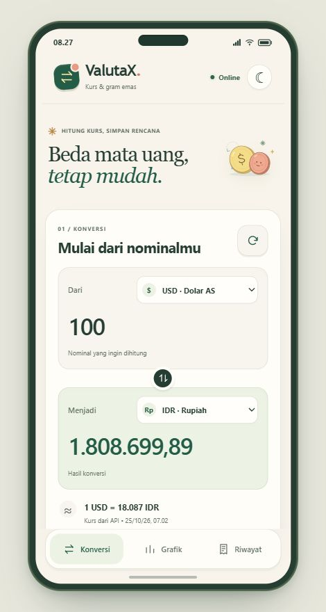
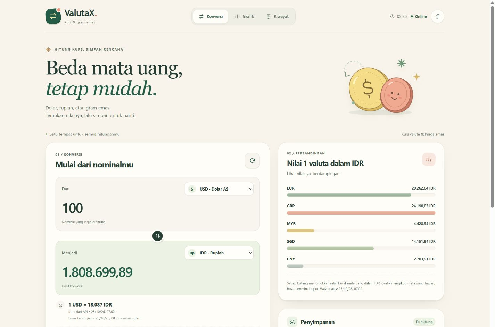

# ValutaX

**Konversi mata uang dan emas, bandingkan nilainya, lalu simpan hasilnya.**

ValutaX adalah aplikasi web berbasis HTML, CSS, dan JavaScript dengan dua pilihan tampilan: antarmuka dalam bingkai HP dan website responsif. Keduanya menggunakan logika konversi, konfigurasi Firebase, serta penyimpanan riwayat yang sama.

[Website responsif](https://ciamonica.github.io/ValutaX/website.html) · [Tampilan HP](https://ciamonica.github.io/ValutaX/) · [Panduan lengkap](https://ciamonica.github.io/ValutaX/PANDUAN.html)

## Pratinjau

<table>
  <tr>
    <th width="30%">Tampilan HP</th>
    <th width="70%">Website responsif</th>
  </tr>
  <tr>
    <td align="center"></td>
    <td align="center"></td>
  </tr>
</table>

## Fitur

- Konversi delapan mata uang: USD, IDR, EUR, GBP, JPY, SGD, MYR, dan CNY.
- Konversi emas dalam satuan gram menggunakan harga spot yang tersedia.
- Grafik perbandingan nilai 1 unit valuta dalam mata uang tujuan.
- Pertukaran mata uang asal dan tujuan, serta tombol penambahan nominal.
- Riwayat lokal, antrean sinkronisasi ke Cloud Firestore, dan unduhan riwayat sebagai JSON.
- Kurs tersimpan untuk perhitungan saat offline dan pembukaan ulang halaman melalui service worker.
- Tema terang/gelap dan penanda navigasi yang mengikuti bagian halaman saat digulir.

## Menjalankan secara lokal

Unduh repositori melalui **Code → Download ZIP**, lalu ekstrak. Tidak diperlukan pemasangan paket JavaScript atau proses build.

### Windows

| Tampilan | Berkas yang dijalankan |
| --- | --- |
| HP | `JALANKAN_WINDOWS.bat` |
| Website responsif | `JALANKAN_WEBSITE_WINDOWS.bat` |

Peluncur memakai PowerShell yang tersedia pada Windows. Biarkan jendela peluncur terbuka selama aplikasi digunakan.

### macOS dan Linux

Gunakan Python 3, lalu jalankan dari folder aplikasi:

```sh
sh JALANKAN_MAC_LINUX.sh
```

Alternatif pada perangkat yang sudah memiliki Python 3:

```sh
python mulai.py
```

Alamat lokal:

- Tampilan HP: [http://localhost:8000/](http://localhost:8000/)
- Website responsif: [http://localhost:8000/website.html](http://localhost:8000/website.html)

Tautan di bagian bawah aplikasi dapat digunakan untuk berpindah tampilan. Gunakan peluncur atau hosting HTTPS agar fitur penyimpanan dan pembukaan ulang offline bekerja sebagaimana dirancang.

## Cara menggunakan

1. Buka aplikasi saat online dan tunggu kurs tersedia.
2. Masukkan nominal, lalu pilih mata uang asal dan tujuan. Hasil diperbarui otomatis.
3. Tekan **Simpan konversi** untuk menambahkan hasil ke riwayat.
4. Perhatikan status **Tersimpan di Firebase** setelah server mengonfirmasi penyimpanan.
5. Gunakan **Unduh riwayat** untuk menyimpan salinan dalam format JSON.

Grafik membandingkan nilai valuta, bukan menunjukkan tren perubahan kurs dari waktu ke waktu.

## Firebase dan penyimpanan

ValutaX menggunakan **Firebase Authentication anonim** dan **Cloud Firestore**. Identitas anonim mengatur akses ke riwayat berdasarkan UID browser melalui `firestore.rules`.

- Kedua tampilan berbagi riwayat dan pilihan tema jika dibuka pada alamat serta browser yang sama.
- Riwayat pada localhost terpisah dari GitHub Pages karena keduanya menggunakan alamat situs yang berbeda.
- Sesi anonim bukan login akun permanen; riwayat tidak otomatis berpindah ke browser atau perangkat lain.
- Riwayat baru disimpan di perangkat terlebih dahulu, lalu dikirim ketika koneksi dan akses Firebase tersedia.
- Menghapus data situs dapat menghapus sesi anonim dan riwayat lokal. Gunakan ekspor JSON untuk menyimpan salinan riwayat.

Untuk memakai proyek Firebase lain, buka **Pengaturan Firebase** (`setup.html`), aktifkan Anonymous Authentication dan Cloud Firestore, lalu terapkan `firestore.rules`. Konfigurasi Web berada di `firebase-config.js`; konfigurasi ini mengidentifikasi proyek, sedangkan akses data ditentukan oleh Authentication dan Security Rules.

## Perilaku offline

Kunjungan pertama memerlukan internet. Pembukaan ulang offline tersedia setelah halaman pernah dibuka melalui HTTPS atau localhost dan pesan kesiapan offline muncul.

Saat offline, perhitungan menggunakan kurs tersimpan beserta waktu pembaruannya. Riwayat baru menunggu sinkronisasi. Aplikasi mencoba mengirim antrean kembali saat koneksi tersedia dan halaman aktif; tidak ada pengiriman latar belakang ketika browser sudah ditutup.

Jika belum ada kurs dari API maupun cache, aplikasi menandai kurs sebagai data contoh. Pilihan emas menunggu harga yang valid.

## Struktur proyek

| Berkas | Fungsi |
| --- | --- |
| `index.html`, `style.css` | Antarmuka dalam bingkai HP. |
| `website.html`, `website.css` | Antarmuka website responsif. |
| `app.js` | Konversi, grafik, navigasi, cache, riwayat, dan sinkronisasi. |
| `firebase-client.js` | Penghubung REST ke Authentication dan Firestore. |
| `firebase-config.js`, `config-utils.js` | Konfigurasi proyek dan validasinya. |
| `setup.html`, `setup.js` | Halaman pengaturan dan pemeriksaan koneksi Firebase. |
| `firestore.rules` | Aturan akses dan validasi riwayat. |
| `sw.js` | Cache halaman untuk pembukaan ulang offline. |
| `mulai_windows.ps1`, `mulai.py` | Server lokal untuk menjalankan aplikasi. |
| `PANDUAN.html` | Panduan penggunaan, rumus, serta penjelasan struktur kode. |

## Teknologi dan sumber data

- **Antarmuka:** HTML5, CSS3, dan JavaScript tanpa framework.
- **Penyimpanan lokal:** `localStorage` dan Cache API melalui service worker.
- **Penyimpanan cloud:** Firebase Authentication dan Cloud Firestore.
- **Kurs valuta:** [ExchangeRate-API](https://www.exchangerate-api.com/).
- **Harga emas:** [Gold API](https://gold-api.com/).

Harga emas merupakan harga spot indikatif yang dikonversi dari troy ounce ke gram. Nilainya dapat berbeda dari harga emas fisik dan produk ritel. Waktu serta sumber kurs ditampilkan pada aplikasi agar hasil dapat dibaca sesuai konteks datanya.
